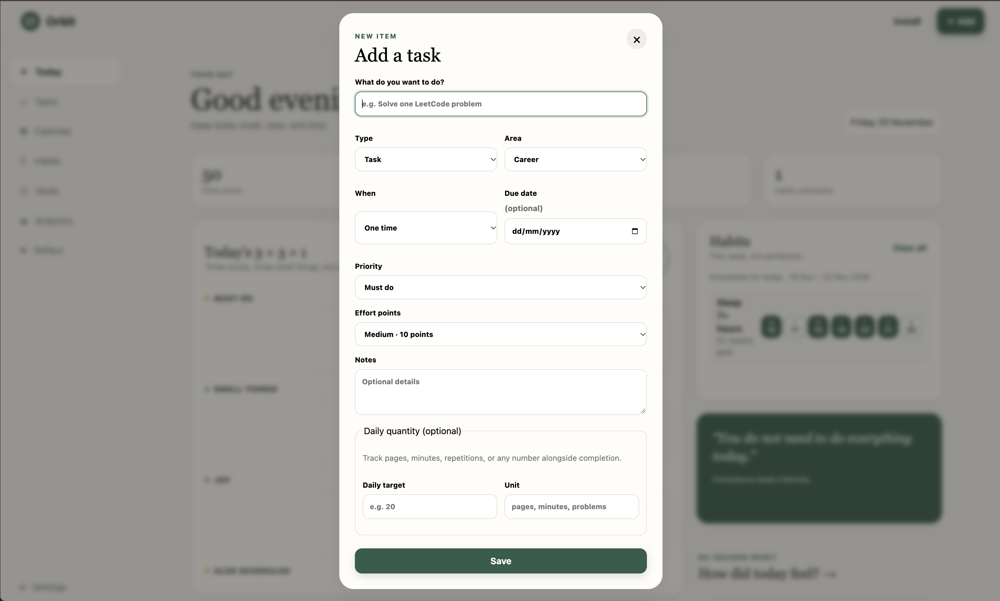

# Orbit

## Introduction

I built Orbit because a task and a habit need different kinds of checklists. A task has a finish line. A habit needs to show up again tomorrow. I wanted to see both when I sat down to plan the day.

## Tech stack

JavaScript and browser local storage power the planner. A service worker supports the installable web app. Supabase provides optional account sync, and Node.js supplies the development server and test runner.

## Features

- Schedule one-time or recurring items. Monthly items scheduled on the 31st fall on the last day of shorter months.
- Log a daily quantity independently of the completion checkbox. In analytics, a recorded zero appears as a value and a missing entry appears as a gap.
- Pin an item to revisit its activity by week, month or year. Orbit calculates history for the selected items and refreshes it when the underlying activity changes.

## The process

I designed and built the planner myself. I gave tasks a priority and due date, and habits a weekly target and quick check-in. I put them side by side in Today so checking off a task and logging a habit each take one visit.

Local profiles persist in the current browser. Use **Settings → Export backup** before clearing browser data or moving a local profile. With Supabase configured, Orbit saves changes locally first and syncs the profile to the signed-in account. The repository includes the database schema and configuration steps. [Cloud setup guide](docs/CLOUD_SETUP.md)

### Reading an activity log

For a reading habit measured in pages, these entries produce three distinct points in the activity history.

| Day | Entry | Chart |
| --- | --- | --- |
| Monday | 12 pages | A point at 12 |
| Tuesday | 0 pages | A point at zero |
| Wednesday | No entry | A gap |

## How it can be improved

The cloud copy stores a profile in one JSON document. I’d test what happens when I edit the same task offline on two devices, then reconnect them in a different order.

## How to run

With Node.js 18 or later, run `npm start` from the repository root and open `http://localhost:8080`. The development server uses Node's built-in modules. In a supported browser, use the install option to open Orbit as a standalone app.

| Command | Result |
| --- | --- |
| `npm run check` | Check JavaScript syntax. |
| `npm test` | Run calendar, analytics and startup tests, including session restoration. |
| `npm run build` | Generate the static site in `dist/`. |

For Cloudflare Pages, use `main` as the production branch, `npm run build` as the build command and `dist` as the output directory. The Workers configuration also supports `npm run deploy` after the build. Publish only the generated `dist/` directory.

## Screenshots

